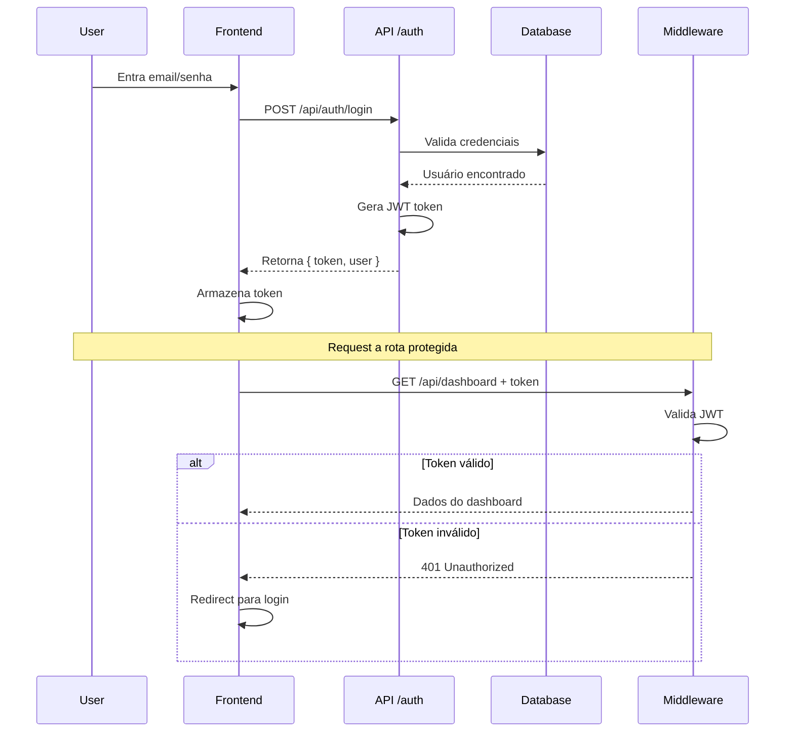

# ISSUE-XXX: [Título Descritivo da Funcionalidade]

> **Esta é a especificação técnica completa desta issue.**  
> Nenhum código é escrito antes deste documento estar aprovado.

---

## 📌 Informações Básicas

**ID:** ISSUE-XXX  
**Título:** [Título Descritivo]  
**Epic:** [Nome do Epic ou "Standalone"]  
**Prioridade:** [🔴 CRITICAL | 🟠 HIGH | 🟡 MEDIUM | 🟢 LOW]  
**Status:** 📝 TODO  
**Responsável:** [Nome ou "Não atribuído"]  
**Estimativa:** XX horas  
**Criada em:** [DD/MM/AAAA]  
**Iniciada em:** [DD/MM/AAAA ou "N/A"]  
**Completada em:** [DD/MM/AAAA ou "N/A"]

---

## 🎯 Objetivo

**O que queremos alcançar com esta issue?**

[DESCREVA EM 2-3 PARÁGRAFOS]

Exemplo:
> "Implementar um sistema completo de autenticação usando JWT tokens. Os usuários devem poder fazer login com email e senha, receber um token de acesso, e usar esse token para acessar rotas protegidas. O sistema também deve suportar refresh tokens para manter a sessão ativa sem exigir novo login frequente."

---

## 🔍 Contexto e Problema

### Situação Atual
**Como as coisas estão hoje?**

[DESCREVA O ESTADO ATUAL]

Exemplo:
> "Atualmente o projeto não possui nenhum sistema de autenticação. Todas as rotas são públicas e não há controle de quem acessa o quê. Isso é um problema de segurança e impede a implementação de features personalizadas por usuário."

### Problema a Resolver
**Qual dor/necessidade esta issue endereça?**

[DESCREVA O PROBLEMA]

Exemplo:
> "Precisamos proteger rotas administrativas e dados sensíveis. Sem autenticação, qualquer pessoa pode acessar o painel admin e manipular dados de todos os usuários."

### Por que Agora?
**Por que esta issue é prioritária neste momento?**

[JUSTIFIQUE A URGÊNCIA/PRIORIDADE]

Exemplo:
> "Esta é a base para todas as próximas features (dashboard, perfil de usuário, permissões). Sem auth, não podemos avançar no roadmap. Além disso, temos um cliente piloto entrando em 2 semanas que exige login seguro."

---

## ✨ Solução Proposta

### Abordagem Escolhida
**Como vamos resolver o problema?**

[DESCREVA A SOLUÇÃO TÉCNICA]

Exemplo:
> "Implementaremos autenticação JWT usando NextAuth.js. O fluxo será:
> 1. Usuário envia credenciais via POST /api/auth/login
> 2. Servidor valida contra banco de dados
> 3. Se válido, gera JWT token com claims (userId, role, expiry)
> 4. Token é retornado ao cliente e armazenado em localStorage
> 5. Requests subsequentes incluem token no header Authorization
> 6. Middleware valida token antes de processar requests protegidos
> 7. Refresh token é usado para renovar access token sem novo login"

### Alternativas Consideradas
**Que outras soluções foram consideradas e por que não foram escolhidas?**

| Alternativa | Prós | Contras | Por que não? |
|-------------|------|---------|--------------|
| Sessions + Cookies | Mais simples | Não escala, problemas com CORS | Queremos API stateless |
| OAuth (Google/GitHub) | UX melhor | Depende de terceiros | Queremos auth próprio também |
| Firebase Auth | Rápido de implementar | Vendor lock-in, custo | Preferimos controle total |

---

## 🏗️ Arquitetura e Design

### Componentes Afetados

#### Novos Componentes
```
✨ src/behaviors/useAuth.ts
   - Hook customizado para lógica de autenticação
   - Funções: login, logout, refreshToken, checkAuth

✨ src/services/auth.service.ts
   - Camada de serviço para chamadas de API
   - Funções: loginUser, logoutUser, validateToken

✨ src/middleware/auth.middleware.ts
   - Middleware para proteção de rotas
   - Valida JWT em cada request protegido

✨ src/types/auth.types.ts
   - Interfaces: User, AuthState, LoginCredentials, JWTPayload

✨ src/components/LoginForm.tsx
   - Componente de UI para formulário de login

✨ src/components/ProtectedRoute.tsx
   - HOC para envolver rotas protegidas
```

#### Componentes Modificados
```
📝 src/app/layout.tsx
   - Adicionar AuthProvider no root

📝 src/app/dashboard/page.tsx
   - Envolver com ProtectedRoute

📝 .env.example
   - Adicionar NEXTAUTH_SECRET, JWT_SECRET
```

### Fluxo de Dados



### Estrutura de Dados

```typescript
// Tipos principais

interface User {
  id: string;
  email: string;
  name: string;
  role: 'admin' | 'user';
  createdAt: Date;
}

interface AuthState {
  user: User | null;
  isAuthenticated: boolean;
  isLoading: boolean;
  error: string | null;
}

interface LoginCredentials {
  email: string;
  password: string;
}

interface JWTPayload {
  userId: string;
  email: string;
  role: string;
  iat: number; // issued at
  exp: number; // expiration
}

interface AuthTokens {
  accessToken: string;
  refreshToken: string;
}
```

---

## 📁 Arquivos e Mudanças

### Arquivos Novos (Criar)

#### `src/behaviors/useAuth.ts`
**Tamanho estimado:** ~150 linhas  
**Responsabilidade:** Hook React com toda lógica de autenticação  

**Funções principais:**
```typescript
export const useAuth = () => {
  // Estado
  const [authState, setAuthState] = useState<AuthState>({...});
  
  // Funções
  const login = async (credentials: LoginCredentials) => {...};
  const logout = () => {...};
  const refreshToken = async () => {...};
  const checkAuth = () => {...};
  
  return { ...authState, login, logout, refreshToken };
};
```

#### `src/services/auth.service.ts`
**Tamanho estimado:** ~100 linhas  
**Responsabilidade:** Chamadas HTTP para API de autenticação  

**Funções principais:**
```typescript
export const authService = {
  login: async (credentials: LoginCredentials) => {...},
  logout: async () => {...},
  refreshToken: async (refreshToken: string) => {...},
  validateToken: async (token: string) => {...},
};
```

#### `src/middleware/auth.middleware.ts`
**Tamanho estimado:** ~80 linhas  
**Responsabilidade:** Validar JWT em rotas protegidas  

#### `src/components/LoginForm.tsx`
**Tamanho estimado:** ~120 linhas  
**Responsabilidade:** UI do formulário de login  

#### `src/components/ProtectedRoute.tsx`
**Tamanho estimado:** ~50 linhas  
**Responsabilidade:** HOC para proteger rotas  

### Arquivos Modificados

#### `src/app/layout.tsx`
**Mudanças:**
```tsx
// Antes
export default function RootLayout({ children }) {
  return <html>{children}</html>;
}

// Depois
import { AuthProvider } from '@/behaviors/useAuth';

export default function RootLayout({ children }) {
  return (
    <html>
      <AuthProvider>{children}</AuthProvider>
    </html>
  );
}
```

#### `.env.example`
**Mudanças:**
```bash
# Adicionar
NEXTAUTH_SECRET=your-secret-here-change-in-production
JWT_SECRET=your-jwt-secret-here
JWT_EXPIRES_IN=15m
REFRESH_TOKEN_EXPIRES_IN=7d
```

---

## ✅ Critérios de Aceitação

**Esta issue só estará completa quando todos os critérios abaixo forem atendidos:**

### Funcionalidades
- [ ] **AC-1:** Usuário pode fazer login com email e senha válidos
- [ ] **AC-2:** Login falha com credenciais inválidas e mostra mensagem de erro apropriada
- [ ] **AC-3:** Token JWT é gerado e armazenado corretamente no localStorage
- [ ] **AC-4:** Rotas protegidas redirecionam para login se usuário não autenticado
- [ ] **AC-5:** Rotas protegidas funcionam normalmente se usuário autenticado
- [ ] **AC-6:** Usuário pode fazer logout e token é removido
- [ ] **AC-7:** Refresh token renova access token automaticamente quando expira
- [ ] **AC-8:** Sessão persiste após reload da página (se token válido)
- [ ] **AC-9:** Sessão expira após período de inatividade configurado
- [ ] **AC-10:** Interface mostra estado de loading durante autenticação

### Segurança
- [ ] **SEC-1:** Senhas nunca são expostas em logs ou respostas de API
- [ ] **SEC-2:** Tokens são validados em todas as rotas protegidas
- [ ] **SEC-3:** HTTPS é obrigatório (redirect de HTTP para HTTPS)
- [ ] **SEC-4:** Rate limiting implementado (máx 5 tentativas/minuto)
- [ ] **SEC-5:** Inputs são sanitizados contra XSS
- [ ] **SEC-6:** JWT secret é diferente em dev/staging/prod

### Performance
- [ ] **PERF-1:** Login completa em < 500ms (p95)
- [ ] **PERF-2:** Validação de token em < 50ms (p95)
- [ ] **PERF-3:** Sem re-renders desnecessários em componentes não relacionados

### UX
- [ ] **UX-1:** Mensagens de erro são claras e acionáveis
- [ ] **UX-2:** Estados de loading são visíveis
- [ ] **UX-3:** Redirect após login leva para página pretendida original
- [ ] **UX-4:** "Remember me" opcional (sessão mais longa)

---

## 🧪 Estratégia de Testes

### Testes Unitários

#### `tests/unit/useAuth.test.ts`
**Coverage esperado:** 100%  
**Cenários:**
```typescript
describe('useAuth', () => {
  it('should login successfully with valid credentials');
  it('should fail login with invalid credentials');
  it('should set isLoading during login');
  it('should clear error on successful login');
  it('should logout and clear user state');
  it('should refresh token automatically before expiry');
  it('should redirect to login if token invalid');
});
```

#### `tests/unit/auth.service.test.ts`
**Coverage esperado:** 100%  
**Cenários:**
```typescript
describe('authService', () => {
  it('should call correct API endpoint for login');
  it('should handle network errors gracefully');
  it('should retry on 5xx errors');
  it('should not retry on 4xx errors');
});
```

### Testes de Integração

#### `tests/integration/auth-api.test.ts`
**Cenários:**
```typescript
describe('Auth API Integration', () => {
  it('should authenticate against real database');
  it('should generate valid JWT token');
  it('should validate token correctly');
  it('should reject expired tokens');
});
```

### Testes E2E

#### `tests/e2e/auth-flow.spec.ts`
**Cenários:**
```typescript
describe('Authentication Flow', () => {
  it('user can login and access dashboard');
  it('user cannot access dashboard without login');
  it('user can logout successfully');
  it('session persists across page reloads');
  it('expired session redirects to login');
});
```

### Testes de Segurança

#### `tests/security/auth-security.test.ts`
**Cenários:**
```typescript
describe('Auth Security', () => {
  it('should reject SQL injection attempts');
  it('should reject XSS in login inputs');
  it('should enforce rate limiting');
  it('should hash passwords before storage');
  it('should use HTTPS only');
});
```

---

## 🚨 Riscos e Mitigações

### Risco 1: Tokens roubados
**Probabilidade:** Média  
**Impacto:** Alto  
**Mitigação:**
- Usar HTTPS obrigatório
- Tokens com expiry curto (15min)
- Refresh tokens para renovação
- Logout remove tokens imediatamente

### Risco 2: Performance com muitos usuários simultâneos
**Probabilidade:** Baixa  
**Impacto:** Médio  
**Mitigação:**
- Validação de token é operação rápida (< 50ms)
- Cache de validações recentes
- Rate limiting previne abuso

### Risco 3: Dependência de NextAuth.js
**Probabilidade:** Baixa  
**Impacto:** Alto  
**Mitigação:**
- NextAuth é bem mantido e popular
- Nossa camada de abstração (useAuth) facilita migração futura
- Testes cobrem toda lógica crítica

### Risco 4: Esqueci minha senha
**Probabilidade:** Alta  
**Impacto:** Baixo  
**Mitigação:**
- Criar ISSUE-008 para password recovery
- Temporariamente: admin pode resetar senha

---

## 🔗 Dependências

### Esta Issue Depende De:
- Nenhuma (é uma issue fundamental)

### Issues que Dependem Desta:
- ISSUE-003: Dashboard (precisa de usuário autenticado)
- ISSUE-009: Login social (extensão do sistema de auth)
- ISSUE-010: Two-factor auth (extensão do sistema de auth)
- ISSUE-015: Perfil de usuário (precisa saber quem está logado)

---

## 📊 Estimativas

### Breakdown de Tempo
```
Planejamento e Spec:          2h  ✅
Setup de libs e configuração: 2h
Implementação do hook:        3h
Implementação do service:     2h
Implementação do middleware:  2h
Componentes de UI:            2h
Testes unitários:            3h
Testes E2E:                  2h
Code review e ajustes:        1h
Documentação:                 1h
-----------------------------------
TOTAL:                       20h
```

### Pontos de História
**Story Points:** 8  
**Justificativa:** Feature de complexidade média-alta, muitos testes necessários, mas escopo bem definido.

---

## 📚 Referências e Recursos

### Documentação
- [NextAuth.js Docs](https://next-auth.js.org/)
- [JWT Best Practices](https://auth0.com/blog/a-look-at-the-latest-draft-for-jwt-bcp/)
- [OWASP Auth Cheatsheet](https://cheatsheetseries.owasp.org/cheatsheets/Authentication_Cheat_Sheet.html)

### Exemplos de Implementação
- [Next.js Auth Example](https://github.com/vercel/next.js/tree/canary/examples/auth)
- [Epic's own auth implementation] (se tiver)

### Design References
- Figma: [Link para designs do login]
- Miro: [Link para fluxogramas]

---

## 📝 Notas e Comentários

### Decisões Técnicas Importantes

**Por que JWT e não Sessions?**
> Decidimos por JWT porque queremos uma API stateless que pode escalar horizontalmente. Sessions exigiriam Redis ou banco de dados compartilhado entre servidores, aumentando complexidade.

**Por que localStorage e não cookies?**
> localStorage oferece mais controle programático e evita problemas de CORS. Sim, é menos seguro contra XSS, mas estamos mitigando com CSP headers e sanitização rigorosa.

**Por que NextAuth.js?**
> É a solução mais madura para Next.js, tem suporte ativo, e oferece plugins prontos para OAuth se precisarmos futuramente.

### Open Questions
- [ ] **Q1:** Devemos suportar login com username OU apenas email?  
  **A:** Apenas email por ora. Username pode ser ISSUE futura.

- [ ] **Q2:** Quantos dias deve durar o refresh token?  
  **A:** 7 dias. Após isso, usuário precisa logar novamente.

- [X] **Q3:** Precisa de email de confirmação no primeiro login?  
  **A:** Não no MVP. Criar ISSUE-011 para implementar futuramente.

---

## ✅ Checklist de Conclusão

**Antes de mover para DONE, todos os itens devem estar ✅:**

### Código
- [ ] Todos os arquivos novos criados
- [ ] Todos os arquivos modificados atualizados
- [ ] Sem código comentado ou TODO's
- [ ] Sem console.log ou debuggers
- [ ] Sem hardcoded secrets ou credenciais

### Testes
- [ ] Coverage > 80% em behaviors e services
- [ ] Todos os testes unitários passando
- [ ] Todos os testes E2E passando
- [ ] Testes de segurança passando

### Qualidade
- [ ] ESLint sem erros
- [ ] TypeScript sem erros (strict mode)
- [ ] Prettier aplicado
- [ ] Build de produção bem-sucedido

### Documentação
- [ ] README atualizado (se necessário)
- [ ] API docs atualizadas (se necessário)
- [ ] Comentários inline em código complexo
- [ ] .ai/context.md atualizado com novas funcionalidades

### Code Review
- [ ] PR criada e linkada
- [ ] Pelo menos 1 aprovação
- [ ] Todos os comments resolvidos
- [ ] Branch atualizada com main

### Deploy
- [ ] Merged para main
- [ ] Deploy em staging bem-sucedido
- [ ] Testes de smoke em staging passaram
- [ ] Deploy em produção bem-sucedido (se aplicável)

---

## 🎯 Definição de Pronto (DoD)

**Esta issue está DONE quando:**

1. ✅ Todos os critérios de aceitação atendidos
2. ✅ Todos os testes passando (unit + integration + E2E)
3. ✅ Code review aprovado
4. ✅ Merged para main
5. ✅ Deploy em staging validado
6. ✅ Documentação atualizada
7. ✅ PM/PO validou funcionalidade
8. ✅ Issue movida para .ai/completed/

---

## 📞 Pontos de Contato

**Responsável pela Issue:** [Nome]  
**Revisor Técnico:** [Nome]  
**Product Owner:** [Nome]  

**Dúvidas?**  
- Slack: #projeto-auth
- Email: dev@projeto.com

---

**Criada:** [DD/MM/AAAA]  
**Última Atualização:** [DD/MM/AAAA]  
**Versão da Spec:** 1.0

---

> **"Uma spec detalhada economiza horas de retrabalho."**
